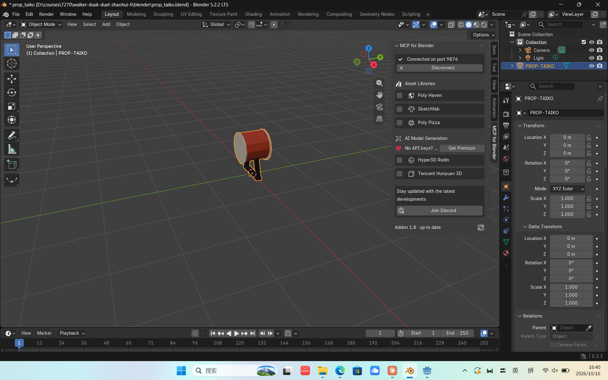

# BLENDER-NOTES — Learn the window (Assignment 3)

> **Whose words:** the descriptions below are Zhaohui's own answers, given in Chinese on 2026-10-16
> and translated into English by Claude Code. Claude only made the English read smoothly and added
> nothing to the substance. The Chinese originals are at the end. Notes marked **Claude's note** are
> factual additions from the session record. They are not Zhaohui's observations.

- **Screenshots taken:** 2026-10-16, 16:40–16:41
- **Blender version:** 5.2.2 LTS (Windows 11)

## 1. 3D viewport

The grid area in the middle of the window, with the drum sitting on it.

## 2. Toolbar

The toolbar has buttons for actions such as rotating and moving.

## 3. Outliner

The Outliner shows the different objects in the scene.

## 4. Properties editor

The Properties editor is where you adjust the different parameters.

## 5. Sidebar (N)

The sidebar shows the state of the interaction with the AI.

> **Claude's note:** in Zhaohui's screenshot the sidebar is open on its **MCP for Blender** tab
> ("Connected on port 9876", libraries and generators unticked). The sidebar's **Item** tab, which
> shows the active object's location, rotation, scale and dimensions, was not open in the screenshot.

## 6. Mode selector (Object Mode / Edit Mode)

It switches between the editing mode and the mode that shows the objects.

## Screenshot

My own Blender session, PROP-TAIKO selected, Object Mode (Win + PrtScn):

Two more of my screenshots, from below and from behind:
[bottom](evidence/blender/zhaohui_bottom_view_taiko.png) ·
[back](evidence/blender/zhaohui_back_view_taiko.png)

## My hand edit

**What I changed:** I edited the drumhead's colour on the taiko. I used L and G.

**What it taught me:** you can work with keyboard shortcuts.

> **Claude's note (what the saved file shows):**
> - **No colour changed.** The comparison of the saved file (16:28) with the committed one found
>   the drumhead material unchanged; its albedo is still `#F2E6D0`, and the Godot check confirms it.
> - **What did change was geometry.** The front drumhead was flattened and its inner ring scrambled,
>   and the drum body moved about 1.2 cm. That fits L (select the linked part under the mouse) and
>   G (grab, which *moves* the selection).
> - **Zhaohui asked Claude to repair it** ("我不太会改，你改吧"). The repair is Claude's; the body
>   nudge was kept. See FRICTIONAL.md and TEST-REPORT.md A3.
>
> Zhaohui's account above is recorded as given.

## Chinese originals (Zhaohui, 2026-10-16)

1. 网格界面，上面有块鼓
2. 工具栏有旋转移动这些按钮
3. 大纲视图用来显示不同的物体
4. 属性编辑器用来调整不同的参数
5. 侧栏显示与AI交互情况
6. 可以切换编辑模式和显示物体模式
7. 当时改的是鼓面的颜色 L 和G
8. 可以使用快捷键操作
