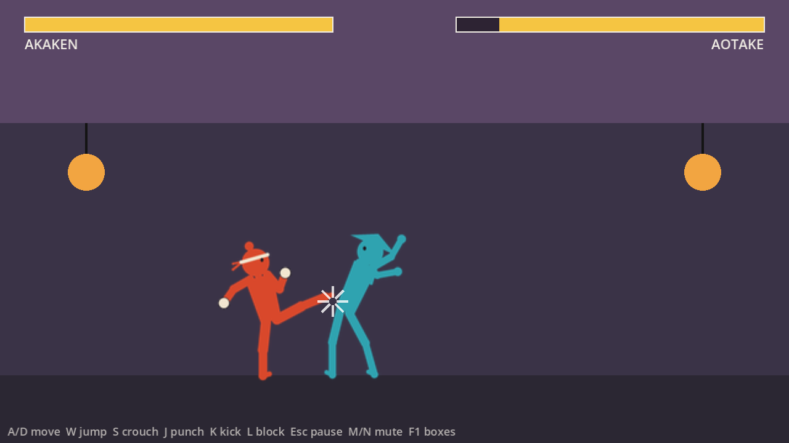
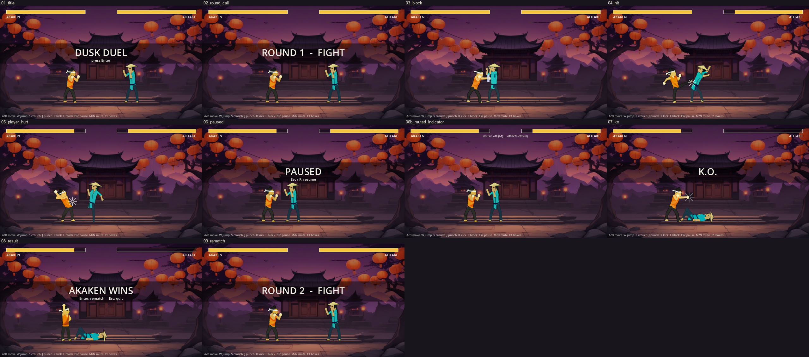
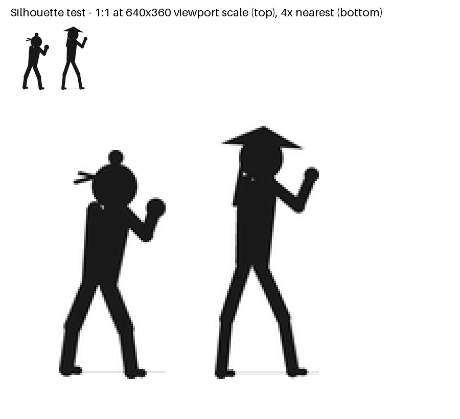
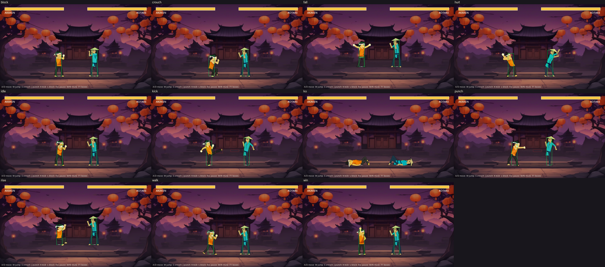
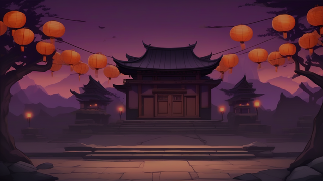
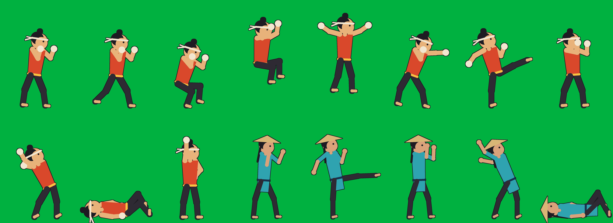
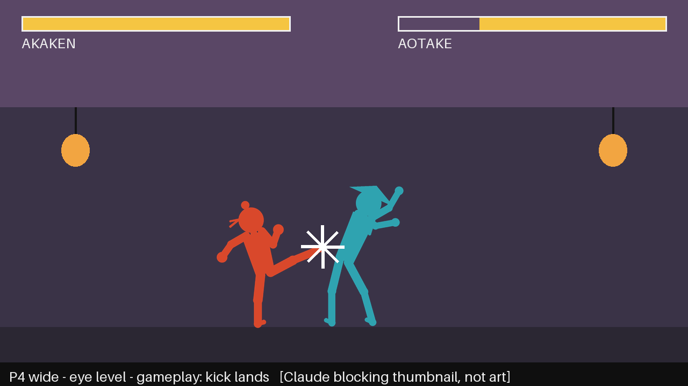
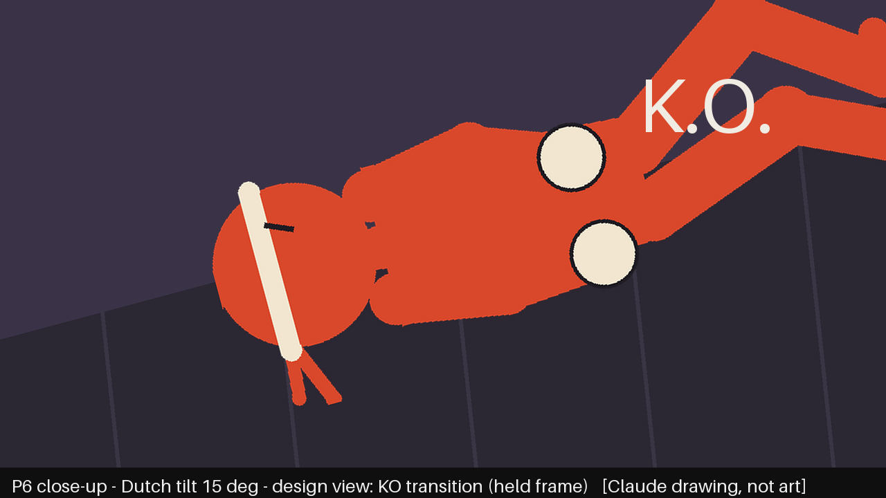
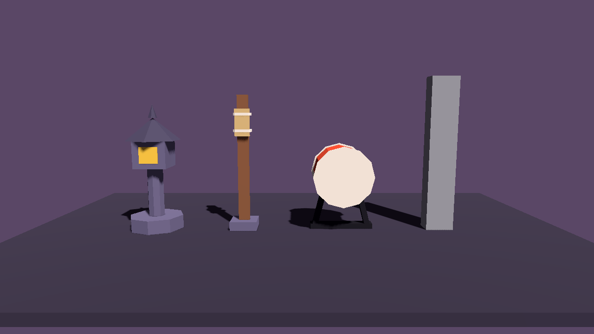

# Game Design Document — Dusk Duel

> Version 1 · 2026-10-22 · Zhaohui Li · CSYE 7270
> This GDD covers the game I am building in this class (`walker-dusk-duel`). Each section says
> what is **built** in the current Godot slice and what is **planned** for the full game.
> Built numbers are copied from the code (`godot/fighter/fighter.gd`, `cpu_controller.gd`,
> `game/main.gd`).



---

## 1. Name of the Game

**Dusk Duel**

## 2. Concept

A one-on-one 2D cartoon martial-arts fighting game set at dusk in a stone temple courtyard.
You play **Akaken**, a stocky brawler in a red gi with huge wrapped fists. You face
**Aotake**, a tall kicker in a straw hat. You win by reading your opponent and deciding, moment
by moment, whether to step in and strike, block, or back off. Button mashing does not win.

| | |
|---|---|
| **Genre** | 2D side-view fighting game (one-on-one duel) |
| **Platform** | PC (Windows), keyboard or gamepad |
| **Players** | 1 player vs CPU (planned: local 2-player versus) |
| **Session length** | One round takes about 30–90 s; a full ladder run (planned) takes about 15 min |
| **Audience** | Casual players who like short, readable fights, in the spirit of classic arcade fighting games but with far fewer buttons |

**Design pillars** (from [CONCEPT.md](CONCEPT.md)):

| Pillar | What it means in play |
|---|---|
| **Every hit is felt** | Contact gets a hurt pose, a white spark, a 4-frame hitstop, a health drop and a dry impact sound, all together |
| **Read the opponent** | Two silhouettes that can't be confused; whiff, block and hit each look and sound different |
| **Dusk ritual** | A calm, ceremonial duel. No blood. The music stops at K.O. |
| **One more round** | A rematch is one key press away, with no menu in between |

**Core loop:** step in → choose punch / kick / block / back off → see and hear the result → reset spacing → repeat.

## 3. Game Flow

```
 ┌────────┐ Enter ┌───────────────────┐ 1 s ┌────────┐ health 0 ┌───────┐ 1.5 s ┌──────────────┐
 │ TITLE  │──────▶│ ROUND n - FIGHT   │────▶│ FIGHT  │─────────▶│ K.O.  │──────▶│ RESULT       │
 │ music  │       │ (input locked)    │     │        │          │ music │       │ "X WINS"     │
 │ starts │       └───────────────────┘     └───┬────┘          │ stops │       └──┬────────┬──┘
 └────────┘                ▲                Esc/P│▲Esc/P        └───────┘    Enter │        │ Esc
                           │                     ▼│                                │        ▼
                           │                ┌────────┐                             │      QUIT
                           │                │ PAUSED │ music ducks −12 dB          │
                           │                └────────┘ + low-pass                  │
                           └───────────────── rematch: full health, music restarts ┘
```

The built flow, captured from the running game ([evidence/flow/](evidence/flow/)):



**Planned flow for the full game:** Title → Mode select (Ladder / Versus / Practice) →
best-of-3 rounds per opponent → next stage → final boss → ending scene and credits.

## 4. Game Elements / Assets

| Type | Asset | Status |
|---|---|---|
| Characters | Akaken: 11 state images (idle, walk, crouch, rise, fall, punch, kick, block, hurt, K.O., win) | Built (generated, SDXL + ControlNet) |
| Characters | Aotake: 5 state images (idle, kick, block, hurt, K.O.) | Built |
| Environment | Temple courtyard at dusk background, 640×360 | Built |
| UI / HUD | Two health bars, name tags, round call, K.O. / win / pause text, mute indicator, control hints | Built |
| Effects | Hit spark (white), block flash (pale blue bars), whiff streak (faint) | Built (drawn in code) |
| Audio | 4 SFX (whiff, hit, block, K.O.) + 1 music loop | Built (Stable Audio Open, MusicGen) |
| 3D props | Stone lantern, makiwara striking post, taiko drum | Built in Blender (A3), not yet in the 2D game |
| Planned | 3 more opponents, 3 more stages, Ki meter UI, special-move effects, menu screens | Planned |

Full list of generations: [ASSET-LOG.md](ASSET-LOG.md) · sources and licences: [SOURCES.md](SOURCES.md).

## 5. Main Character(s)

| | **Akaken** (player) | **Aotake** (CPU rival) |
|---|---|---|
| Look | Short, stocky, about 5 heads tall; sleeveless red-orange gi, yellow belt, cream hand wraps and headband, topknot | Tall and lean; teal robe, navy sash, wide straw hat, long braid |
| Height on screen | 112 px | 124 px |
| Style | Close-range brawler: fast jab and a strong kick | Long-legged kicker who keeps you at the edge of the kick's reach |
| Personality | Hot-headed, eager, the young challenger | Calm, patient, the temple's guardian |
| Key colours | Gi `#D9482B`, wraps `#F2E6D0`, belt `#F5C542` | Robe `#2FA3B0`, hat `#D8B676`, sash `#17324D` |



The silhouettes are built to read at 112 px: topknot and headband tails against hat brim and long
legs, warm colours against cool. Each fighter's 11 states are drawn from one fixed skeleton, so the
limbs stay the same length in every pose:



**Planned roster (full game):**

- **Kuromori**: a heavy monk in black who fights with slow, armoured strikes (stage 3).
- **Shirokaze**: a fast masked fighter in white, the final boss, who can use Ki moves (stage 4).

Full details: [CHARACTER-SHEET.md](CHARACTER-SHEET.md).

## 6. Story

Every autumn, on the evening of the last harvest moon, the mountain temple of **Yūhi-ji**
holds the Dusk Duel. Any fighter who climbs the thousand steps may challenge the temple's
guardians. Whoever wins a duel before the last lantern burns out earns the right to ring the great
taiko drum.

Akaken is a village kid who trained by punching a makiwara post behind the family rice mill.
Akaken has never beaten anyone who wasn't a fence post. The first guardian at the gate is Aotake,
who has turned away every challenger for ten years by never letting them get close.

The story is told with very little text: a short card before each stage, the fighters' poses,
and the sky growing darker from stage to stage. If you beat the final guardian, you ring the
taiko as night falls and the courtyard lanterns light up one by one. If you lose, the challenger
walks back down the steps, and the rematch prompt is already waiting.

## 7. Gameplay

### 7.1 Goal: why is the player playing?

- **Short term:** bring the opponent's health from 100 to 0 before they do it to you.
- **Long term (planned):** climb the temple ladder by beating four guardians and ring the drum.
- **What the player gets out of it:** the satisfaction of *reading* someone. You see a kick coming,
  block it, and punish it. Every round is short, so a loss feels like a lesson, not a punishment.

### 7.2 Game Mechanics: what actions does the player take?

| Action | Keyboard | Gamepad | What it does (built values, 60 fps) |
|---|---|---|---|
| Walk | A / D or ← / → | D-pad / stick | Forward 90 px/s, backward 70 px/s; you always face the opponent |
| Jump | W / ↑ | D-pad up | Jump speed 330 px/s, gravity 900 px/s²; you can jump over the opponent |
| Crouch | S / ↓ | D-pad down | Smaller hurtbox, so high attacks pass over you |
| **Punch** | J | X | Startup 4 · active 4 · recovery 10 frames · **8 damage** |
| **Kick** | K | A | Startup 7 · active 5 · recovery 16 frames · **14 damage**, longer reach |
| **Block** | L (hold) | RB | Stops all damage from the front; 10 frames of blockstun and a small push back |
| Pause / mute | Esc or P / M, N | Start | Pause the fight; mute music or effects |

**Rules that make the decisions matter:**

- **Risk and reward:** the kick does almost twice the damage of the punch but takes almost twice as
  long. If it whiffs, you are open for 16 frames.
- **Hitstun:** a clean hit freezes both fighters for 4 frames (hitstop), then the victim is stunned
  for 18 frames and pushed away.
- **Interrupts:** if you get hit during your own attack's startup, your attack is cancelled.
- **Fair collision:** only the body core can be hit. Fists, hat brim and headband tails are
  cosmetic and cannot be hit. Hitboxes cover the forearm (punch) or shin (kick), and only during
  active frames. Press F1 to see the boxes.

**CPU opponent (built):** Aotake re-decides every 10 frames, so it reacts late, like a person.
It blocks your attacks 55 % of the time when close, walks in when out of range, backs off when
too close, and kicks 50 % of the time when in range (40-frame cooldown).

### 7.3 Abilities and Power-ups

The current slice has **no power-ups**; it uses only the basic moves above. The full game adds
(planned):

| Ability / power-up | How you get it | Effect |
|---|---|---|
| **Ki meter** | Fills when you land hits (+) and block hits (++). Blocking fills it most, which rewards good reads | Shown under the health bar, 3 segments |
| **Iron Fist** (Akaken special) | Down, forward + Punch, costs 1 Ki segment | A heavy charging punch, 18 damage, armoured through one hit |
| **Guard Break** | Forward + Kick, costs 1 Ki segment | Breaks a block; stops a CPU that only blocks |
| **Counter** | Block in the last 4 frames before a hit lands, costs nothing | "Perfect block": no blockstun, so you can punish at once |
| **Lantern blessing** | One per stage: a lantern glows at the arena edge; touch it | Restores 15 health, then the lantern goes dark (tests whether you spend time to heal) |
| **Taiko rhythm** (final stage) | The temple drum beats every 2 s | Attacks timed on the beat do +25 % damage |

### 7.4 Levels and Challenges

Each stage is a best-of-3 duel at a different spot on the temple grounds. The sky gets darker
from stage to stage.

| # | Stage | Opponent | New challenge | Status |
|---|---|---|---|---|
| 0 | Training yard (practice) | Makiwara post (does not fight back) | Learn spacing and the timing of punch and kick | Planned (makiwara model built in A3) |
| 1 | **Temple courtyard** | **Aotake** | Get past a long-range kicker; learn to block and punish | **Built (one round)** |
| 2 | Lantern bridge | Aotake, rematch | Narrow arena (less room to back off); CPU blocks more often | Planned |
| 3 | Bell tower | Kuromori | Armoured slow hits; you must use Guard Break and spacing | Planned |
| 4 | Drum hall (night) | Shirokaze | Fast boss who uses Ki moves; taiko rhythm bonus | Planned |

Difficulty rises through the CPU's settings, which are already constants in `cpu_controller.gd`:
shorter reaction time, higher block chance, shorter kick cooldown.

### 7.5 Losing or Restarting

- **Lose a round:** your health reaches 0 → K.O. → music stops → input locked for 1.5 s →
  the opponent wins and poses.
- **Double K.O.:** if both fighters hit 0 on the same frame, the round is a draw ("DOUBLE K.O.").
- **Restart:** press Enter on the result screen. The rematch starts at once with full health,
  start positions and the music from the top. Esc quits.
- **Planned:** lose 2 rounds out of 3 and you lose the stage; **Continue** restarts that stage
  (not the whole ladder), so the "one more round" pillar holds.

### 7.6 Player Skills: what would a good player be good at?

1. **Spacing:** standing just outside the opponent's kick reach and stepping in only when it's safe.
2. **Reading:** spotting the start of an attack and blocking in time (the CPU reacts every
   10 frames; a good player reacts faster).
3. **Punishing:** striking right after a blocked or whiffed attack, while the opponent is still
   recovering.
4. **Choosing the right move:** a fast punch when there's little time, a kick when the opponent is
   committed.
5. **Patience:** not mashing. A whiffed kick costs 28 frames in total.
6. **Planned:** managing the Ki meter, and timing perfect blocks and taiko-beat attacks.

## 8. Graphics and Styling

**Style:** flat cel-shaded cartoon, about 5 heads tall, thick dark outline, 3–5 flat colours per
fighter, no texture. Bright fighters stand in front of a darker dusk-purple courtyard, so the
action stays readable (contrast checked with WCAG luminance, see CHARACTER-SHEET).

| Element | Example |
|---|---|
| Arena background: purple sky, red lanterns, temple roof, grey stone |  |
| Colour-block design sheet used to steer the image model |  |
| Storyboard: wide, eye-level gameplay camera |  |
| Storyboard: Dutch-tilt K.O. close-up |  |
| 3D props for future stages (lantern, makiwara, taiko) |  |

**Palette**

| Role | Hex |
|---|---|
| Dusk sky | `#5A4766` |
| Wall band (behind the fighters) | `#3A3347` |
| Floor stone | `#2B2733` |
| Akaken gi / wraps / belt | `#D9482B` / `#F2E6D0` / `#F5C542` |
| Aotake robe / hat / sash | `#2FA3B0` / `#D8B676` / `#17324D` |
| Outline | `#1E1B22` |

**Camera:** one fixed side view at eye level that shows the whole 640×360 arena (scaled 2× to
1280×720). The fighters never leave the screen. Storyboard: [STORYBOARD.md](STORYBOARD.md).

**Readability rules:** each fighter state is a single static image; the hurt pose always leans
*away* from the attacker; every event also has a visual signal, so the game can be played with the
sound off.

## 9. Music and Sound Effects

| Sound | When it plays | Character |
|---|---|---|
| **MUS-LOOP** | Starts on the title screen and loops during the fight | Sparse taiko pulse and wooden flute: calm focus that tightens |
| **SFX-WHIFF** | An attack's active frames end without contact | Light air swish |
| **SFX-HIT** | A clean hit | Short, dry, bass-heavy impact with no reverb tail |
| **SFX-BLOCK** | A hit lands on a block | Hard wooden clack, clearly different from a hit |
| **SFX-KO** | Health reaches 0 | The heaviest impact; then silence |

**Audio rules (built in `AudioDirector`):**

- Each event sound plays **exactly once** per event. The director only listens to game signals
  and never decides anything itself.
- **Pause:** music ducks −12 dB behind a low-pass filter, a muffled "held breath".
- **K.O.:** music stops at once, so the silence marks the ending.
- **Rematch:** music restarts from the beginning of the loop.
- **M / N** mute music / effects separately, with an on-screen indicator.

**Planned:** one music variation per stage (more drums as the night goes on), a crowd murmur, a
lantern-blessing chime, and the great taiko hit for the ending.

Tools: Stable Audio Open 1.0 (SFX), MusicGen medium (music), run in
`notebooks/generate_audio.ipynb`.

## 10. Technical Description

| | |
|---|---|
| **Engine** | Godot 4.7.2 stable, GL Compatibility renderer |
| **Language** | GDScript |
| **Resolution** | 640×360 viewport, shown at 2× (1280×720) |
| **Target** | Windows 11 PC, keyboard and gamepad |
| **Timing** | Fixed 60 Hz physics tick. All gameplay is counted in frames, which makes it deterministic |

**Architecture**

```
main.gd (round flow: title → intro → fight → ko → result)
 ├── Fighter P1  ◀── PlayerController (reads input → Intent)
 ├── Fighter P2  ◀── CpuController    (seeded RNG → Intent)
 │     fighter.gd: state machine (idle, walk, crouch, jump, punch, kick, block, hurt, ko, win)
 │     fighter_art.gd: one texture + hurtbox/hitbox per state, from data/poses.json
 ├── Effects      (spark / flash / streak, listens to attack_resolved)
 ├── HUD          (health bars, messages)
 └── AudioDirector (listens to signals only; Music and SFX buses)
```

- **Custom kinematics, not the physics engine:** main.gd steps both fighters, *then* checks hits,
  *then* pushes grounded fighters apart. Each attack resolves exactly once as `hit`, `blocked`,
  `whiff` or `interrupted`.
- **Controllers produce an `Intent`** (move, jump, crouch, attack, block), so the player, the CPU
  and scripted tests drive a fighter in the same way. Local 2-player versus only needs a second
  PlayerController.
- **Testing:** a headless test runner (`godot --headless --path godot --script res://tests/test_runner.gd`)
  scripts whole fights frame by frame and checks hits, blocks, K.O. and the sound once-per-event rule.
  `check_props3d.gd` runs 49 checks on the 3D props.
- **Asset pipeline:** pose skeletons and colour blocks (Python, `tools/`) → SDXL + OpenPose
  ControlNet + IP-Adapter on Google Colab → one PNG per state; audio from Stable Audio Open and
  MusicGen; 3D props built in Blender 5.2.2 through the Blender MCP → glTF → Godot.
- **Known limits:** Aotake has only 5 poses (walk and jump reuse other images); the CPU was tuned by
  tests, not yet by playtesting; the generated audio is licensed for non-commercial use only.

**How to run**

```bash
godot --path godot
```
